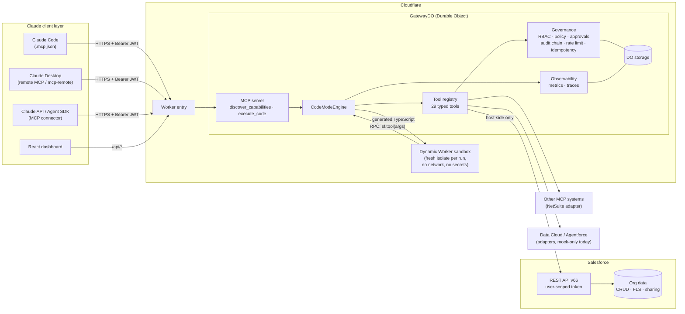
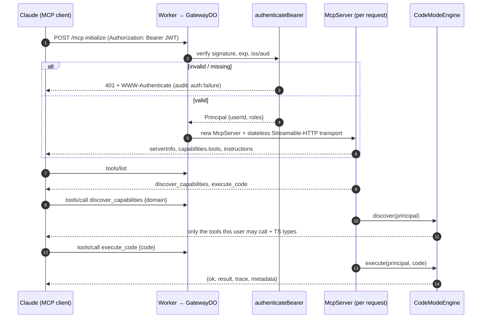
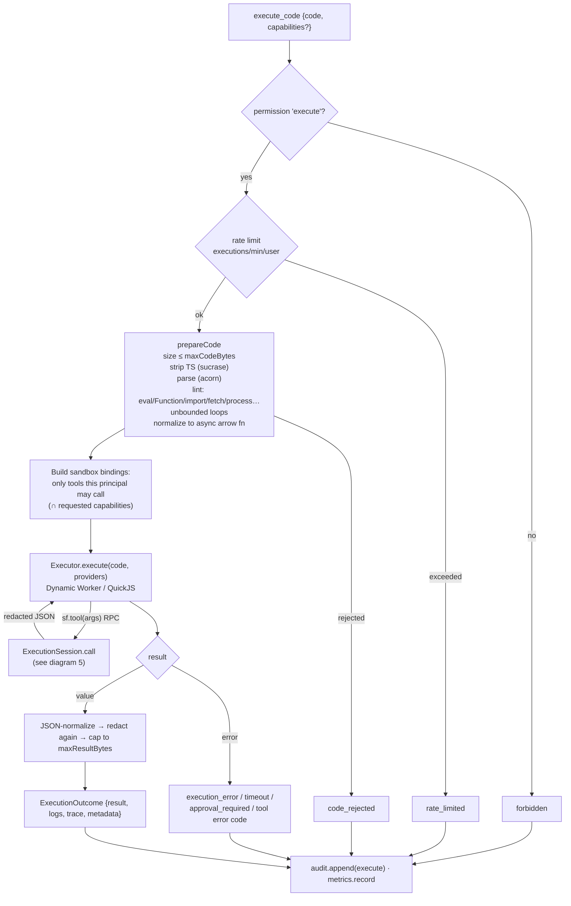
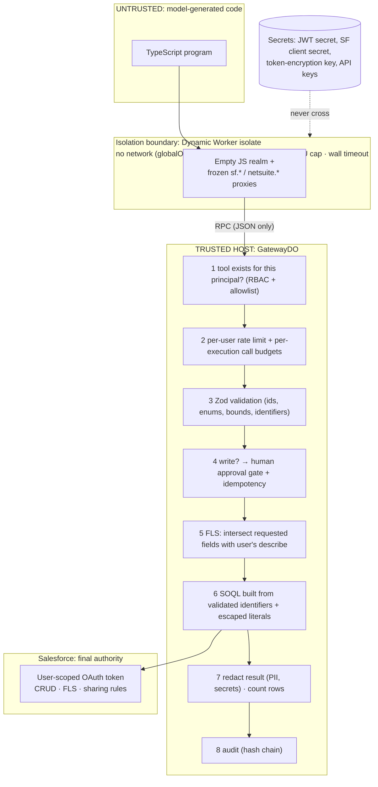
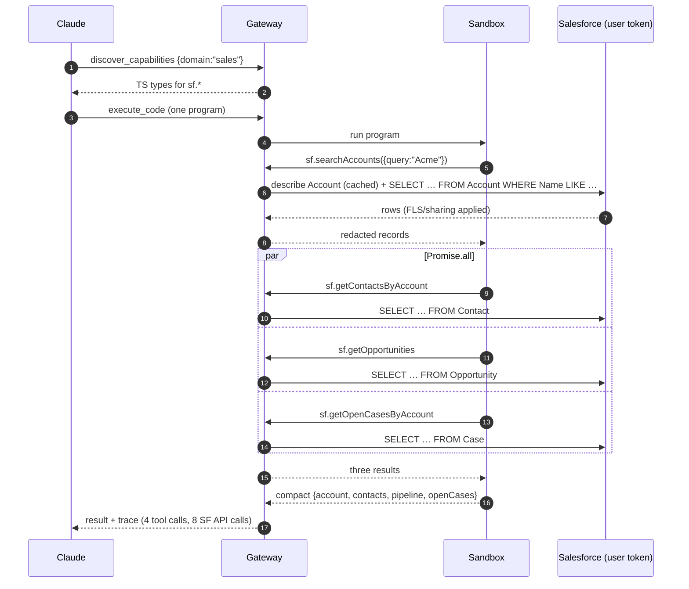
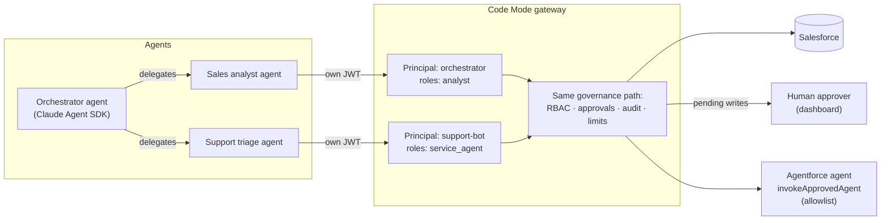
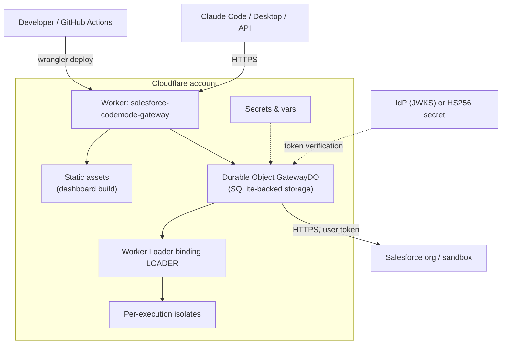
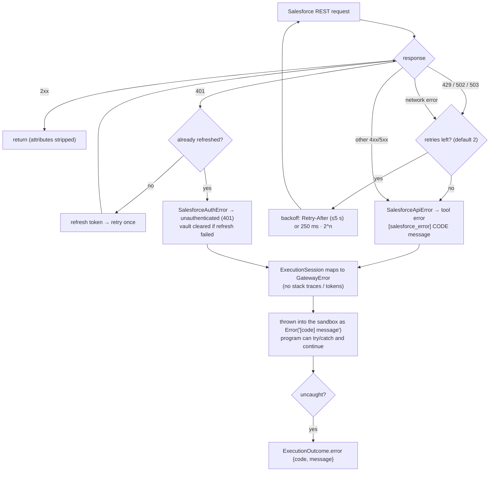

# Architecture

This document describes the system as implemented in this repository. Each diagram is followed by an explanation that points at the code.

**Contents:** [1 Overall](#1-overall-architecture) · [2 MCP lifecycle](#2-mcp-request-lifecycle) · [3 Code Mode execution](#3-code-mode-execution-lifecycle) · [4 OAuth](#4-salesforce-oauth-flow) · [5 Security boundaries](#5-security-boundaries) · [6 Account 360](#6-account-360-sequence) · [7 Multi-agent](#7-multi-agent-integration) · [8 Deployment](#8-deployment-architecture) · [9 Errors & retries](#9-error-handling-and-retries) · [10 Approvals](#10-human-approval-workflow)

## 1. Overall architecture



**Reading it.** Claude never talks to Salesforce. It talks to the gateway's *two* MCP tools. `execute_code` hands a TypeScript program to the sandbox; every `sf.*` call in that program is an RPC back to the host, where `ExecutionSession.call` ([session.ts](../packages/tool-registry/src/session.ts)) applies authorization, validation, approvals, limits, redaction and auditing before touching Salesforce with the *user's own* OAuth token. The sandbox holds no credentials and has no network.

## 2. MCP request lifecycle



**Notes.** The transport is stateless (`sessionIdGenerator: undefined`, JSON responses): a fresh `McpServer` is built per HTTP request with the authenticated principal bound by closure ([mcp.ts](../apps/worker/src/mcp.ts)). There is no server-side session to hijack; every request is authenticated independently. `/mcp/direct` serves the *traditional* one-tool-per-capability surface through the same governance path and is used as the evaluation baseline.

## 3. Code Mode execution lifecycle



**Notes.** Generated code is plain TypeScript; types are stripped, never executed through `eval`/`Function`. Static checks give fast, clear errors but are explicitly **not** the security boundary (see [security.md](security.md)). Two interchangeable executors implement the same `Executor` contract as `@cloudflare/codemode`: `DynamicWorkerExecutor` (production, wrapped by `withLimits` for CPU caps) and `QuickJsExecutor` (WASM, used for Node tests and local scripts).

## 4. Salesforce OAuth flow

```mermaid
sequenceDiagram
  autonumber
  participant U as User (dashboard)
  participant G as Gateway (GatewayDO)
  participant SF as Salesforce login
  participant V as TokenVault (AES-256-GCM)

  U->>G: POST /api/oauth/start (Bearer JWT)
  G->>G: PKCE: verifier, S256 challenge, random state
  G->>G: store sha256(state) → {userId, verifier, exp 10 min}
  G-->>U: authorizeUrl (state + challenge only)
  U->>SF: GET /services/oauth2/authorize
  SF-->>U: user logs in and consents
  SF-->>G: GET /oauth/callback?code&state
  G->>G: look up + delete state (single use), check expiry
  G->>SF: POST /services/oauth2/token (code, code_verifier, client_id[, secret])
  SF-->>G: access_token, refresh_token, instance_url
  G->>V: encrypt + save under userId
  G-->>U: 302 /?salesforce=connected
  Note over G,SF: later calls use the user's token. On 401: refresh once;<br/>if refresh fails the vault entry is deleted and the user must re-authorize.
  U->>G: POST /api/oauth/logout
  G->>SF: POST /services/oauth2/revoke
  G->>V: delete
```

**Notes.** Tokens are per Claude user, so Salesforce itself enforces *that user's* CRUD, field-level security and sharing. The integration is **not** a shared admin identity. The code verifier never reaches the browser; `state` is stored hashed and consumed on first use. See [oauth-setup.md](oauth-setup.md).

## 5. Security boundaries



**Notes.** Defense in depth, with an explicit hierarchy: *Salesforce's own enforcement is the final authority*; the host re-checks everything; the sandbox is only one layer and is **not claimed to be sufficient alone**. The numbered host checks live in `ExecutionSession.call`.

## 6. Account 360 sequence



**Notes.** One model round trip for the work instead of one per call. Raw rows never enter the model's context; only the program's aggregated return value does. The `describe` calls power field-level security filtering and are cached per execution.

## 7. Multi-agent integration



**Notes.** Each agent authenticates with its **own** token and gets its own role, rate limits, audit identity and Salesforce profile; agents do not share credentials or inherit the orchestrator's permissions. Writes from any agent pause for a human. Agentforce is called as a governed, allowlisted tool (currently via the mock adapter; see [tool-registry.md](tool-registry.md)).

## 8. Deployment architecture



**Notes.** One Worker, one Durable Object, one Worker Loader binding, static assets for the dashboard ([wrangler.jsonc](../wrangler.jsonc)). The single global DO gives a consistent audit chain, approval queue and rate limiter with no extra infrastructure; to scale out, shard by tenant (`idFromName(tenantId)`). Details in [deployment.md](deployment.md).

## 9. Error handling and retries



**Notes.** Writes are **not** automatically retried (non-idempotent at the Salesforce layer). Idempotency for approved writes is enforced at the gateway: an approval is single-use and its result is stored under `write:<approvalId>`. Unknown exceptions become `internal_error` with no detail, by design ([errors.ts](../packages/security/src/errors.ts)).

## 10. Human approval workflow

```mermaid
sequenceDiagram
  autonumber
  participant A as Agent (service_agent)
  participant G as Gateway
  participant AP as ApprovalService
  participant H as Human approver (dashboard)
  participant SF as Salesforce

  A->>G: execute_code → sf.createCase({...})
  G->>AP: consumeIfApproved(tool, args, user)?
  AP-->>G: none
  G->>AP: requestOrGet → apr_123 (pending, fingerprint = hash(tool, args, user))
  G-->>A: error approval_required {approvalId: apr_123}  (nothing written)
  H->>G: GET /api/approvals → sees tool + exact args
  H->>G: POST /api/approvals/apr_123/approve
  Note over G,AP: requester ≠ approver (four-eyes); must hold approvals.decide
  A->>G: re-run the same program
  G->>AP: consumeIfApproved → status consumed (atomic, single use)
  G->>SF: create Case with the USER's token (CRUD/FLS still enforced by Salesforce)
  SF-->>G: {id, success}
  G-->>A: result  (audit: approval.consumed, tool.invoke)
  A->>G: run again
  G-->>A: approval_required (a fresh approval is needed)
```

**Notes.** An approval authorizes **exactly one execution of exactly these arguments by exactly this requester**, and expires after `approvalTtlMs` (1 h default). Changing any argument changes the fingerprint, so a tampered re-run needs a new approval. All state transitions are serialized by a keyed mutex (a race in the first implementation was found by the benchmark and fixed; see the concurrency test in `tests/unit/governance.test.ts`).
